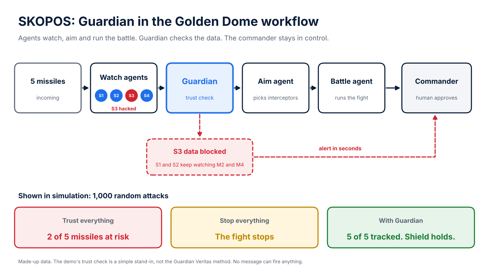

# SKOPOS: Guardian for Golden Dome, shown in simulation

MIT AI Studio, Fall 2026, Homework 8.

## The story

**1. The attack.** Five missiles are incoming. Satellites track them. AI picks the interceptors. The commander approves.

**2. The failure.** Seconds later, one satellite fails. Maybe it was hacked. It was tracking two of the five missiles.

**3. Without Guardian.** Which data is bad? Nobody knows. The operator has two bad choices. Trust everything, and they may miss. Stop everything, and they lose the fight.

**4. With Guardian.** The commander knows in seconds. The bad data is blocked. Other satellites pick up the two missiles. The shield holds.

**Who uses it.** Agents that watch. Agents that aim. Agents that run the battle. The commander stays in control.

## The workflow



```
 5 missiles
     |
 Watch agents S1 S2 S3 S4  --track reports-->  Trust check ("Guardian" role)
                                                 |            \
                                          trusted reports    bad satellite blocked
                                                 |              + alert to commander
                                             Aim agent
                                                 |
                                           Battle agent  --approval request-->  Commander (human)
                                                 ^                                   |
                                                 +-------------- approved -----------+
```

S3 is hacked partway through and starts reporting false positions for M2 and M4. S1 also watches M2, and S2 also watches M4, so good data still exists.

## What the simulation shows

Same attack, three ways. 1,000 random versions (failure time, size and direction of the false jump, sensor noise, missile speeds).

| Mode | All 5 missiles tracked correctly | Fight stopped |
|---|---|---|
| Trust everything (no check) | 0% (M2 and M4 at risk every time) | 0% |
| Stop on any conflict (no check) | 0% | 100% |
| Trust check in the loop | 100% | 0% |

With the trust check, the bad satellite was blocked and the commander was alerted within the same one-second update, in every trial.

The same story run also works with every agent as a separate Nanda Town participant. Each report, alert, plan and approval is a real Town mailbox message (sent, claimed and acknowledged). The result matches the in-memory run.

## Run it

Python 3.11+. The quick run needs nothing but the standard library.

```sh
python examples/skopos/run_demo.py                      # in memory, seconds
python -m pip install -e '.[dev]'
python examples/skopos/run_demo.py --town --out /tmp/skopos-result.json
python -m pytest tests/test_skopos_example.py -q
```

No model key, network service, paid API or deployment is used.

## Limits (please read)

- All data are made up. Flat 2-D toy geometry, straight-line flight.
- The trust check here is a simple plausibility rule written for this class demo: block a satellite that reports a position no missile could reach in one update. It shows where a trust layer sits in the workflow. It is **not Guardian Veritas** and does not show how Guardian Veritas works. No Guardian Veritas code or method is in this repository.
- The rule catches a sudden, impossible jump. A slow, gradual spoof was not tested and might not be caught by this rule.
- The commander is a scripted stand-in for a human approval click. Nothing proceeds without that approval.
- No message can fire anything. There is no weapon or interceptor model. "At risk" only means the aim point is more than 5 km off.
- These results show the workflow in simulation. They are not evidence of real-world performance.
- Town's current profile schema needs a quote task, so the run uses a zero-value placeholder. This is a custom scenario check, not a native Town evaluator pass or TOWN-TESTED badge.
